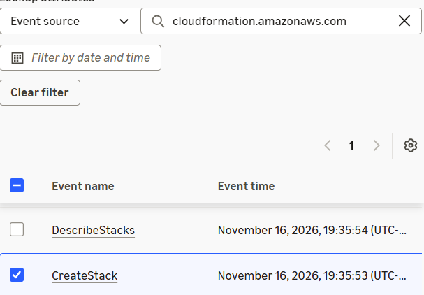
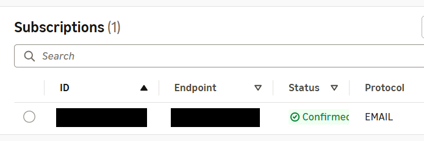
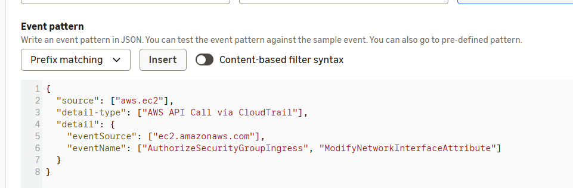
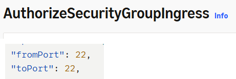
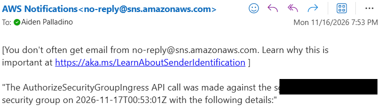
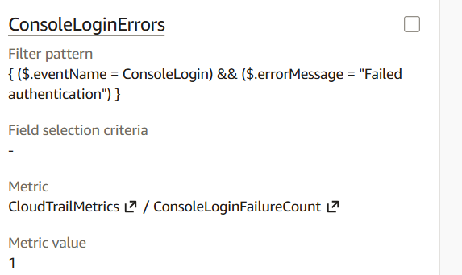
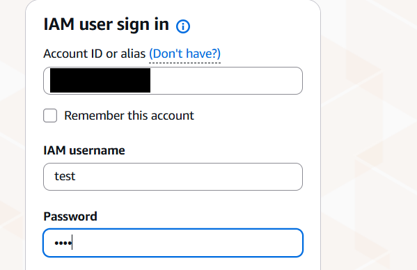
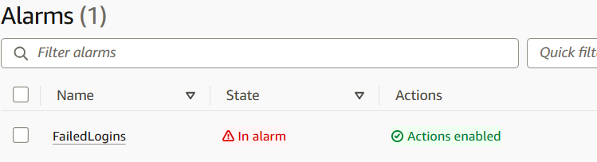
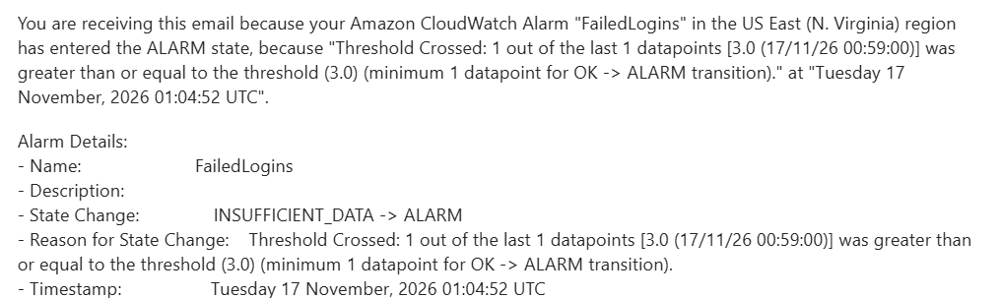
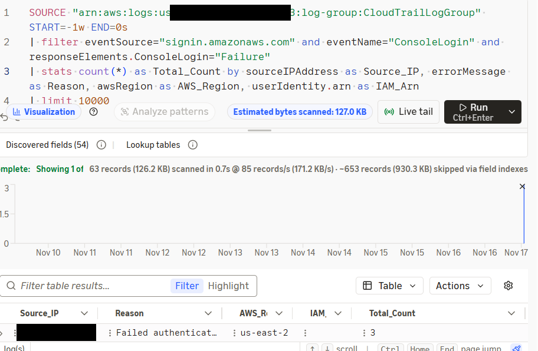

# Monitoring and Alerting with CloudTrail, EventBridge and CloudWatch (AWS Lab)

| | |
|---|---|
| **Platform** | AWS Academy lab (via Canvas) |
| **Services** | CloudTrail, EventBridge, SNS, CloudWatch Logs, CloudWatch Alarms, Logs Insights |
| **Key techniques** | API audit logging, event-pattern detection, metric filters, threshold alarms, log queries |

## Summary
I set up two detections in an AWS account and tested both. The first emails me when someone adds an inbound rule to a security group. The second fires an alarm when there are 3 or more failed console logins within 5 minutes. Both are built on CloudTrail logs. At the end I used CloudWatch Logs Insights to query the failed logins by source IP and user.

## How the alerts flow

```
Security group change:
  API call -> CloudTrail -> EventBridge rule (event pattern) -> SNS topic -> email

Failed console logins:
  ConsoleLogin failure -> CloudTrail -> CloudWatch Logs -> metric filter -> alarm (>= 3 in 5 min) -> SNS topic -> email
```

## Step 1: CloudTrail

CloudTrail records API calls in the account: who made the call, when, from where, and what changed. I filtered Event history by event source `cloudformation.amazonaws.com` and opened the `CreateStack` event from when the lab started. The record shows `userIdentity`, `eventTime`, `awsRegion` and the request details.



Event history only keeps 90 days of management events. To keep logs longer and send them to CloudWatch, you need a trail. I went through the Create trail wizard (new S3 bucket, CloudWatch Logs enabled, the LabCloudTrailRole IAM role, management events for both reads and writes), but the lab account doesn't have permission to finish creating it, so I cancelled. The lab already had a trail called `LabCloudTrail` with the same settings, and I used that one for the rest of the lab.

## Step 2: SNS topic for alerts

I created a Standard SNS topic called `MySNSTopic` and subscribed my email to it, then confirmed the subscription from the email AWS sent. Both alerts send to this topic.



## Step 3: Detecting security group changes with EventBridge

I created a rule called `MonitorSecurityGroups` on the default event bus with this event pattern:

```json
{
  "source": ["aws.ec2"],
  "detail-type": ["AWS API Call via CloudTrail"],
  "detail": {
    "eventSource": ["ec2.amazonaws.com"],
    "eventName": ["AuthorizeSecurityGroupIngress", "ModifyNetworkInterfaceAttribute"]
  }
}
```

`AuthorizeSecurityGroupIngress` is the API call behind adding an inbound rule, and `ModifyNetworkInterfaceAttribute` covers swapping which security groups are attached to an instance. EventBridge only sees these "API Call via CloudTrail" events because a trail is logging them.



The target is MySNSTopic. I used an input transformer to pull out a few fields so the email starts with a readable sentence before the raw details:

```json
{"name":"$.detail.requestParameters.groupId","source":"$.detail.eventName","time":"$.time","value":"$.detail"}
```

```
"The <source> API call was made against the <name> security group on <time> with the following details:"
" <value> "
```

### Testing it

To trigger the rule, I added an inbound rule to LabSecurityGroup on LabInstance: SSH (port 22) from `0.0.0.0/0`. That's exactly the kind of risky change this alert is meant to catch.

In CloudTrail I found the matching `AuthorizeSecurityGroupIngress` event. The record showed `fromPort` and `toPort` as 22, with the same `eventSource` and `eventName` the rule looks for.



A minute later the alert email arrived.



## Step 4: Alarm on failed console logins

The trail sends its logs to a CloudWatch log group (`CloudTrailLogGroup`). On that log group I created a metric filter called `ConsoleLoginErrors`:

```
{ ($.eventName = ConsoleLogin) && ($.errorMessage = "Failed authentication") }
```

Every log event that matches adds 1 to a custom metric, `ConsoleLoginFailureCount`, in the `CloudTrailMetrics` namespace.



Then I created an alarm called `FailedLogins` on that metric: if the sum is greater than or equal to 3 within a 5-minute period, notify MySNSTopic.

### Testing it

I opened the console sign-in link for the lab's `test` IAM user and signed in with a wrong password three times. Each attempt showed the incorrect-credentials error. That also logged me out of the lab console, so I signed back in through the lab page.



The `ConsoleLoginFailureCount` metric showed a data point, the alarm moved to **In alarm**, and the alarm email arrived.





## Step 5: Querying the logs with Logs Insights

Alerts tell you something happened, but you still need to dig in. In CloudWatch Logs Insights (now under Log Analytics in the console) I ran this query against `CloudTrailLogGroup`:

```
filter eventSource="signin.amazonaws.com" and eventName="ConsoleLogin" and responseElements.ConsoleLogin="Failure"
| stats count(*) as Total_Count by sourceIPAddress as Source_IP, errorMessage as Reason, awsRegion as AWS_Region, userIdentity.arn as IAM_Arn
```

It filters to failed console logins and counts them by source IP, error reason, Region and the user that was targeted. The results showed 3 failed logins from a single source IP, matching my three tries. The `IAM_Arn` column came back empty, because CloudTrail leaves the user ARN out of failed console logins, so the source IP is the main lead. In a real investigation, this is how I'd answer whether it's one user getting their password wrong or one IP trying many accounts.



## What I'd change in production
- **The SNS topic lets everyone publish and subscribe.** The lab set the access policy to Everyone. Anyone could flood the alert channel with fake alerts or subscribe to read real ones. I'd lock it down so only this account, EventBridge and CloudWatch can publish.
- **The security group rule misses a lot.** It only matches two event names. An inbound rule changed with `ModifySecurityGroupRules`, a new group from `CreateSecurityGroup`, or an outbound rule from `AuthorizeSecurityGroupEgress` would get no alert. I'd add those, and filter on the risky part (a `0.0.0.0/0` source) so the alert doesn't fire on every routine change.
- **Nothing alerts if logging is turned off.** An attacker's first move is often `StopLogging` or `DeleteTrail`. Both detections depend on CloudTrail, so I'd add an alert on those events too.
- **The alert email is mostly raw JSON.** For triage I'd trim it to who made the change, what changed, when, and the source IP.
- **The alarm only counts failures.** A failed burst followed by a successful `ConsoleLogin` from the same IP is the more serious case, and this setup wouldn't flag it.

## Lessons Learned
- CloudTrail is the base for everything here. If a trail isn't logging, EventBridge and the CloudWatch metric filter have nothing to work with.
- EventBridge suits "tell me every time X happens," while a metric filter plus an alarm suits "tell me when X happens too many times."
- Writing the event pattern made me look at what a CloudTrail record actually contains (`eventSource`, `eventName`, `requestParameters`), which is the same thing I'd read in a SIEM.
- The Logs Insights query is basically a hunting query: filter, then group by IP and user. That carries straight over to SIEM work at the ReliaQuest Labs program and to log analysis topics on Security+.
- It's a good companion to my separate security groups lab: that one was about restricting network access with security group rules, and this one was about getting alerted when those kinds of rules change.
