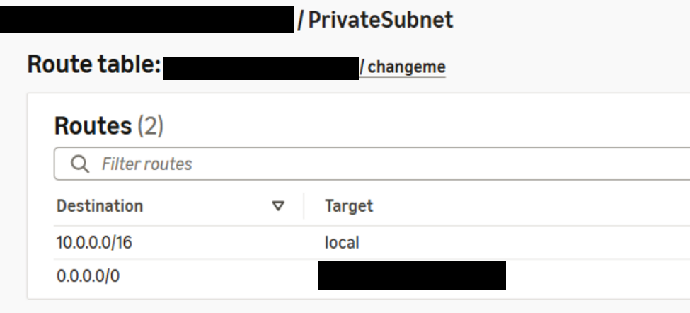
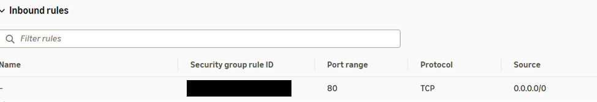
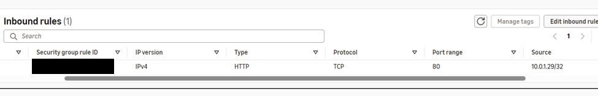
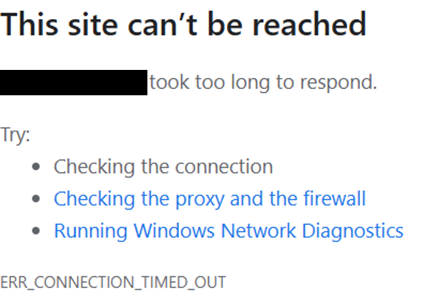
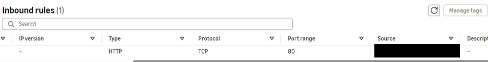
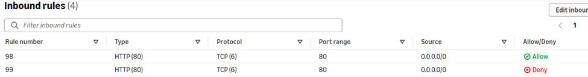
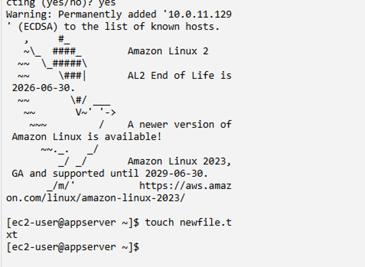
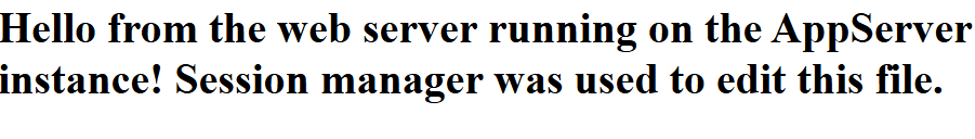

# Securing VPC Resources with Security Groups and Network ACLs (AWS Lab)

| | |
|---|---|
| **Platform** | AWS Academy lab (via Canvas) |
| **Services** | VPC, EC2, Security Groups, Network ACLs, Systems Manager Session Manager |
| **Key techniques** | Least-privilege inbound rules, security group referencing, NACL rule ordering, bastion host with SSH agent forwarding, Session Manager |

## Summary
The lab started with a VPC that had two proxy servers in public subnets forwarding web traffic to an app server in a private subnet. Every security group allowed HTTP from anywhere. I tightened the app server's access in stages, first to one IP and then to a security group, tested how a network ACL interacts with security groups, and then got a shell on the private app server two ways: SSH through a bastion host, and Session Manager with no SSH at all.

## Starting setup

| Resource | Subnet | Notes |
|---|---|---|
| ProxyServer1 | PublicSubnetA | ProxySG, public IP, forwards port 80 to the AppServer |
| ProxyServer2 | PublicSubnetB | ProxySG2, public IP, forwards port 80 to the AppServer |
| AppServer | PrivateSubnet | AppServerSG, private IP only |

The private subnet's route table sends `10.0.0.0/16` to `local` and `0.0.0.0/0` to a NAT gateway in PublicSubnetA. The public subnets send `0.0.0.0/0` to an internet gateway, which is what makes them public. So the AppServer can reach out to the internet through the NAT gateway, but nothing on the internet can start a connection to it.



AppServerSG started with one inbound rule allowing HTTP on port 80 from `0.0.0.0/0`. The private subnet kept it off the internet, but inside the VPC anything could reach it. I also added an HTTP from anywhere rule to ProxySG2 so both proxies matched, and loaded each proxy's public IP in a browser. Both showed the AppServer's page.



## Step 1: Restricting the AppServer to one IP

I changed the AppServerSG HTTP rule's source from `0.0.0.0/0` to ProxyServer1's private IP with `/32`, which means that single address.

```
Type: HTTP   Port: 80   Source: <ProxyServer1PrivateIP>/32
```



ProxyServer1 still loaded the site. ProxyServer2 hung and timed out, because the AppServer now dropped traffic from any other source. Security groups don't send a rejection, they just drop the packet, which is why it's a timeout and not an error page.



## Step 2: Referencing a security group instead of an IP

Hardcoding IPs doesn't scale. Every new proxy would need its own rule, and an IP can change if an instance is replaced. So I deleted the `/32` rule and added an HTTP rule whose source is the ProxySG security group. Then I moved ProxyServer2 off ProxySG2 and onto ProxySG.

```
Type: HTTP   Port: 80   Source: ProxySG (sg-xxxxxxxx)
```



*(The source column is the ProxySG group; I blacked out its ID.)*

Both proxies loaded the site again. Now any instance with ProxySG attached can reach the AppServer on port 80, and any instance without it can't, whatever its IP is.

## Step 3: Network ACLs

Network ACLs are a second layer that works at the subnet level. Unlike security groups, they're stateless and evaluated in rule-number order, lowest first. I added an inbound rule to the LabVPC network ACL:

```
Rule 99   HTTP (80)   0.0.0.0/0   DENY
```

ProxyServer1 timed out right away, even though ProxySG still allowed port 80. Traffic has to be allowed by both the NACL and the security group, and either one can block it.

Then I added:

```
Rule 98   HTTP (80)   0.0.0.0/0   ALLOW
```

The site loaded again. Rule 98 is checked before 99, matches the traffic first, and the deny never gets evaluated.



## Step 4: SSH to the private server through a bastion host

The AppServer has no public IP, so I can't SSH to it directly. I renamed ProxyServer2 to `Bastion`, created a `BastionSG` security group allowing SSH (port 22), and swapped ProxySG on that instance for BastionSG. Then I added an SSH rule to AppServerSG allowing only the bastion's private IP (`/32`).

From the lab's Ubuntu terminal, which is outside the AWS account:

```bash
exec ssh-agent bash
ssh-add ~/.ssh/labsuser.pem
ssh -i ~/.ssh/labsuser.pem -A ec2-user@<BastionPublicIP>
```

`ssh-agent` holds the key in memory, and `-A` forwards the agent through the connection. The bastion can use my key to authenticate onward, but the `.pem` file never gets copied onto it. If the bastion were compromised, the key wouldn't be sitting there for an attacker to take.

From the bastion:

```bash
ssh ec2-user@<AppServerPrivateIP>
touch newfile.txt
```

The prompt changed from `[ec2-user@bastion]` to `[ec2-user@appserver]`, and I created `newfile.txt` to prove I was on the AppServer.



## Step 5: Session Manager

Systems Manager Session Manager gets a shell on an instance without opening port 22, without a bastion, and without an SSH key. Amazon Linux comes with the SSM agent installed, and access is controlled through IAM. I chose AppServer → Connect → Session Manager and got a `sh-4.2` shell in the browser.

To prove it worked, I edited the web page on the AppServer:

```bash
sudo sed -i 's/instance!/instance! Session manager was used to edit this file./g' /var/www/html/index.html
```

`sed -i` edits the file in place, swapping the word `instance!` for the same word plus my added sentence. Reloading ProxyServer1's public IP showed the new text.



## What I'd change in production
- **BastionSG allows SSH from `0.0.0.0/0`.** Anyone on the internet can try to log in. I'd limit it to my own IP or a company VPN range.
- **NACL rule 99 does nothing.** With rule 98 allowing the same traffic first, the deny never runs. It reads like protection but isn't. Rules that cancel each other out should be cleaned up.
- **I'd skip the bastion.** Since Session Manager works, I'd remove the SSH rules and close port 22 entirely. Session Manager also logs sessions through CloudTrail, which helps with audits and investigations.
- **ProxySG still allows HTTP from anywhere.** That's fine for a public web proxy, but in a real setup I'd put HTTPS in front of it, not plain port 80.

## Lessons Learned
- Referencing a security group as the source is cleaner than listing IPs, because access follows the role of the server, not its address.
- Security groups and NACLs both have to allow traffic. Security groups are stateful and per instance; NACLs are stateless, per subnet, and rule order matters.
- A timeout usually means a firewall is silently dropping traffic. That's a useful clue when troubleshooting connectivity.
- SSH agent forwarding lets you hop through a bastion without leaving your private key on it.
- From a SOC point of view, every rule change here (`AuthorizeSecurityGroupIngress`, `CreateNetworkAclEntry`, `ModifyInstanceAttribute`) and every Session Manager login (`StartSession`) shows up in CloudTrail. A sudden `0.0.0.0/0` rule on port 22 is exactly the kind of change I'd want an alert on.
